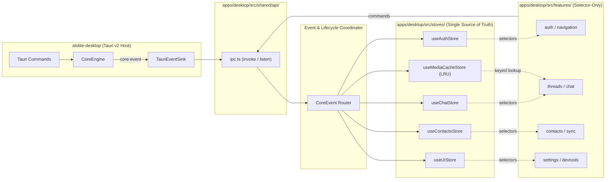
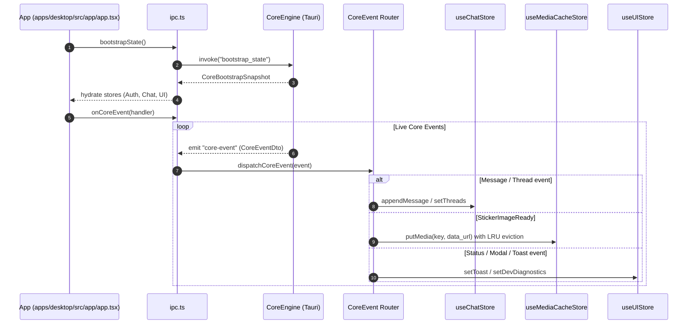

# Frontend Domain Stores & Media Cache Migration

## Overview & Context

`apps/desktop/src/` currently operates with a split-brain state layer: `useAppStore` in `apps/desktop/src/app/store/use-app-store.ts` executes the monolithic `appReducer` over `AppState`, then invokes `syncDomainStores(next)` to overwrite `useAuthStore`, `useUIStore`, `useChatStore`, and `useContactsStore` under `apps/desktop/src/stores/`. Meanwhile, feature components subscribe to `useAppStore()` (and `useChatStore()`) without selectors, causing whole-tree re-renders on every `CoreEventDto` and silently resetting domain-local fields (`devDiagnostics`, `sendingMsgIds`, `syncProgress`, `lastSyncStats`). Additionally, `mediaCache` in `apps/desktop/src/app/store/coreEvents/media.ts` grows unbounded in the JS heap.

This specification defines the migration to the architecture established in `docs/adr/0006-frontend-domain-stores-and-selector-discipline.md`.

### Goals

- Eliminate `appReducer`, `AppState`, `useAppStore`, and `syncDomainStores` so the four Zustand + Immer stores under `apps/desktop/src/stores/` become the single source of truth.
- Route `CoreEventDto` payloads directly to domain store actions.
- Isolate `mediaCache` into a dedicated, bounded LRU cache (`useMediaCacheStore`) so sticker/image hydration does not trigger `useChatStore` subscribers or leak WebView memory.
- Enforce selector-only subscriptions across all 8 feature slices under `apps/desktop/src/features/` so React Compiler memoization remains effective.

### Non-Goals

- Changing `CoreEngine` Rust commands, `CoreEventDto` wire schemas, or `apps/desktop/src/shared/types/ipc.generated.ts`.
- Migrating media/sticker transport from base64 `data_url` payloads to Tauri's `asset:` protocol / `convertFileSrc` (tracked separately in GitHub issue `#64`).

---

## Architecture

### Target Module Changes

- **Shared UI Types (`apps/desktop/src/stores/types.ts`)**: Relocate `NavSection`, `ContactsSubTab`, `SettingsTab`, and `ImageViewerState` out of `apps/desktop/src/app/store/app-state.ts` so `useUIStore` and `useContactsStore` have zero dependency on `app/store/`.
- **Bounded Media Store (`apps/desktop/src/stores/use-media-cache-store.ts`)**: Manage `mediaCache` as an insertion-ordered LRU `Map<string, string>` (capped by entry count, e.g. 250 entries) plus sticker store/pack metadata, decoupled from `useChatStore`.
- **Direct Event Router (`apps/desktop/src/app/store/coreEvents/`)**: Refactor `handleCoreEvent` and domain handlers (`login.ts`, `messages.ts`, `media.ts`, `sync.ts`, `settings.ts`, `contacts.ts`) to invoke `.getState()` actions on the target Zustand stores rather than returning a cloned `AppState`.
- **Feature Slice Migration (`apps/desktop/src/features/`)**: Replace every `useAppStore()` and bare `useChatStore()` call with granular selectors (`useChatStore((s) => s.selectedThreadId)`) and direct store actions or `ipc` calls.

---

## Operational Flow

### Cross-Store Lifecycle Transitions

1. **Bootstrap (`CoreBootstrapSnapshot`)**: Hydrate `useAuthStore` (identity, saved accounts), `useChatStore` (threads, settings, pinned packs), and `useUIStore` (theme, `devMode`, `activeDbPath`, `inlineVideoSupported`) in a single coordinator function.
2. **Logout / Account Switch / Wipe (`LoggedOut`, `AccountSwitched`, `LocalDataWiped`)**: Explicitly reset `useChatStore`, `useContactsStore`, and `useMediaCacheStore` alongside `useAuthStore.setLoggedOut()`, preventing stale messages or media from leaking across accounts.

---

## Security & Reliability

- **UI Thread Non-Blocking (`INV-3`)**: All network, SQLite, and image decoding remain inside `CoreEngine`. Store actions and selectors perform synchronous in-memory updates only.
- **Account Isolation on Switch/Wipe**: Resetting `useChatStore`, `useContactsStore`, and `useMediaCacheStore` on `LoggedOut`, `AccountSwitched`, and `LocalDataWiped` prevents cross-account data exposure in the WebView.
- **Bounded WebView Memory**: `useMediaCacheStore` evicts oldest entries once capacity is reached, preventing unbounded base64 `data_url` accumulation in the WebKit process until issue `#64` (`convertFileSrc`) lands.
- **Zero Silent State Loss**: Removing `syncDomainStores` eliminates hardcoded resets of `devDiagnostics`, `sendingMsgIds`, `syncProgress`, and `lastSyncStats`.
- **Verification Gate**: Every migration step must pass `(cd apps/desktop && bun run check && bun test && bun run build)`.

---

## Domain Invariant Taxonomy

| ID           | Invariant                                                                                                                                               | Verification Mapping                                                                               |
| :----------- | :------------------------------------------------------------------------------------------------------------------------------------------------------ | :------------------------------------------------------------------------------------------------- |
| **INV-3**    | The UI thread (`apps/desktop/src/`) never performs blocking I/O; all I/O delegates to `CoreEngine` via `apps/desktop/src/shared/api/ipc.ts`.            | Code review & `oxlint --type-aware` boundary checks                                                |
| **INV-4**    | Message rows in `useChatStore` remain idempotent by `msg_id` / `cli_msg_id` during optimistic send and server echo reconciliation.                      | `apps/desktop/src/stores/stores.test.ts` & `apps/desktop/src/features/chat/utils/messages.test.ts` |
| **INV-FE-1** | Every `apps/desktop/src/stores/` slice is the sole owner of its state; no secondary shadow reducer or `setState` mirror (`syncDomainStores`) may exist. | Removal of `use-app-store.ts` / `app-reducer.ts` + `tsc --noEmit`                                  |
| **INV-FE-2** | Feature components must subscribe via granular Zustand selectors (`useStore((s) => s.field)`); bare `useStore()` calls are disallowed.                  | `rg "use(Auth                                                                                      | UI  | Chat | Contacts)Store\(\)" apps/desktop/src/` returns zero matches |
| **INV-FE-3** | `useMediaCacheStore` enforces a strict upper bound on cached `data_url` entries via LRU eviction.                                                       | Unit test in `apps/desktop/src/stores/stores.test.ts`                                              |
