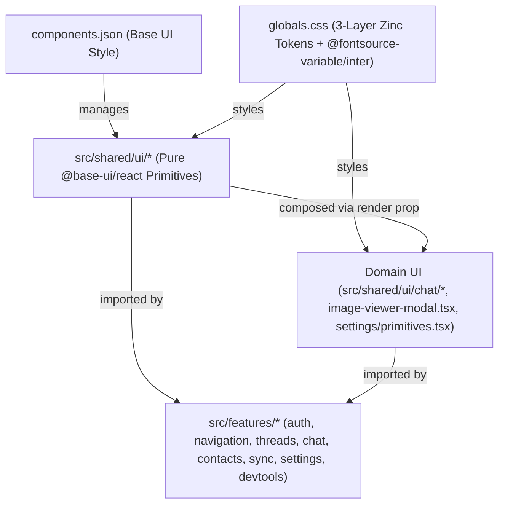

# shadcn/ui Base UI Migration & Zinc Design System

## Overview & Context

`apps/desktop` currently implements 14 UI primitives in `apps/desktop/src/shared/ui/` on top of 9 `@radix-ui/react-*` packages without a `components.json` manifest. Meanwhile, feature modules (`settings/`, `contacts/`, `threads/`, `chat/`, `devtools/`, `navigation/`) still contain raw `<select>`, `<button>`, `<input>`, and ad-hoc modal/card markup, as well as hardcoded Zalo Blue hex values.

### Goals

- Establish `apps/desktop/components.json` configured for **shadcn/ui Base UI** (`@base-ui/react`) and Tailwind CSS v4.
- Replace all `@radix-ui/react-*` dependencies and `asChild` / `Slot` usage with `@base-ui/react` and the `render` prop pattern.
- Audit `apps/desktop/src/features/` and install only demand-driven shadcn/ui components (`select`, `alert-dialog`, `card`, `textarea`, `label`) to eliminate duplicated raw HTML controls.
- Apply the **Zinc minimalist palette** (`#FFFFFF` / `#18181B` / `#E4E4E7` light; `#09090B` / `#FAFAFA` / `#27272A` dark) onto the existing 3-layer CSS variable schema in `apps/desktop/src/app/styles/globals.css`.
- Bundle `@fontsource-variable/inter` offline for consistent Vietnamese rendering and `tabular-nums` on Linux `webkit2gtk-4.1`.

### Non-Goals

- Installing unused shadcn/ui registry components (Chart, Carousel, Calendar, Menubar, Pagination, DataTable).
- Introducing Material Design 3 token names (`surface-container-lowest`, `on-surface-variant`, etc.) into `globals.css`.
- Modifying Rust `CoreEngine`, Tauri IPC commands, or Zustand domain stores (`ADR-0006`).
- Rewriting domain-specific chat components (`src/shared/ui/chat/chat-bubble.tsx`, `src/shared/ui/chat/chat-message-list.tsx`, `src/shared/ui/image-viewer-modal.tsx`) into generic primitives.

---

## Architecture

The frontend UI layer separates upstream Base UI primitives managed by `components.json` from domain wrappers and feature slices, sharing a single 3-layer token stylesheet.

### Token & Component Boundaries

| Layer               | Location                                                                               | Ownership                        | Rules                                                                                                                                      |
| :------------------ | :------------------------------------------------------------------------------------- | :------------------------------- | :----------------------------------------------------------------------------------------------------------------------------------------- |
| **Design Tokens**   | `apps/desktop/src/app/styles/globals.css`                                              | Hand-maintained SSOT             | 3 layers only (`--rail`/`--sidebar`/`--canvas`, shadcn core, `--bubble-in`/`--bubble-out`/`--online`/`--warning`). CLI must not overwrite. |
| **Pure Primitives** | `apps/desktop/src/shared/ui/*.tsx`                                                     | `shadcn` CLI (`components.json`) | Built exclusively on `@base-ui/react`. No `asChild`, no `@radix-ui/*`, no domain store imports.                                            |
| **Domain Wrappers** | `src/shared/ui/chat/*`, `image-viewer-modal.tsx`, `settings/components/primitives.tsx` | Feature/App maintained           | Compose `shared/ui/` primitives (e.g., `SwitchRow`, `SelectRow`, `SettingCard`).                                                           |
| **Feature Views**   | `apps/desktop/src/features/*`                                                          | Feature slices                   | Zero raw `<select>`, zero ad-hoc confirm modals, zero hardcoded theme hexes.                                                               |

---

## Operational Flow

Migration proceeds in strict dependency order so `tsc --noEmit`, `oxlint --type-aware`, and `vite build` remain verifiable at completion.

```mermaid
sequenceDiagram
    autonumber
    participant Dev as Engineer / CLI
    participant Deps as package.json & components.json
    participant CSS as globals.css & index/main
    participant UI as src/shared/ui/*
    participant Feat as src/features/*

    Dev->>Deps: Initialize components.json (Base UI) & install @base-ui/react, @fontsource-variable/inter
    Dev->>CSS: Map Zinc palette to 3-layer tokens + configure Inter & tabular-nums + <=220ms motion
    Dev->>UI: Regenerate/migrate 13 primitives to Base UI + add select, alert-dialog, card, textarea, label
    Dev->>Feat: Rewrite asChild -> render prop (nav-rail, threads-sidebar, message-actions, composer)
    Dev->>Feat: Replace data-[state=checked] -> data-checked & replace raw <select>/<button>/hexes
    Dev->>Deps: Uninstall all @radix-ui/* packages & verify typecheck + lint + test + Tauri build
```

### Critical Breaking-Change Transitions

- **Trigger Composition (`asChild` -> `render`)**: Nested triggers in `apps/desktop/src/features/navigation/components/nav-rail.tsx` (e.g. `TooltipTrigger` + `DropdownMenuTrigger` + `Button`) must compose via Base UI's `render` prop so refs, ARIA attributes, and event handlers merge without extra wrapper DOM nodes.
- **Stateful CSS Selectors (`data-[state=*]` -> `data-*`)**: Base UI exposes `data-checked`, `data-unchecked`, `data-open`, `data-closed`, `data-disabled` directly. All custom overrides (including `SwitchRow` in `apps/desktop/src/features/settings/components/primitives.tsx` and `utilities-tab.tsx`) must migrate off `data-[state=checked]`.
- **High-Contrast Outgoing Bubbles**: In Light mode, `--canvas` (`#FAFAFA`), `--bubble-in` (`#FFFFFF` with `#E4E4E7` border), and `--bubble-out` (`#18181B` with `#FAFAFA` text) preserve clear visual separation while `--rail` uses `#18181B` (Light) and `#09090B` (Dark).

---

## Security & Reliability

- **Zero External Font/Asset Requests**: Bundling `@fontsource-variable/inter` via Vite eliminates external CDN calls (`fonts.googleapis.com`), preserving offline reliability and preventing network metadata leakage in a privacy-focused messaging client.
- **No Protocol or Store Coupling**: UI primitives in `src/shared/ui/` remain strictly stateless presentation/interaction wrappers; `CoreEngine` IPC (`apps/desktop/src/shared/api/ipc.ts`) and Zustand selectors (`ADR-0006`) remain untouched.
- **Destructive Action Guardrails**: `WipeConfirmModal` (`apps/desktop/src/features/settings/components/wipe-confirm-modal.tsx`) migrates to Base UI `AlertDialog` so accidental `Escape` / backdrop clicks or focus loss cannot trigger `ipc.wipeLocalData()` unintentionally.
- **Reduced Motion Compliance**: All transition utilities respect `@media (prefers-reduced-motion: reduce)` and cap durations at `120ms`–`220ms` to avoid frame drops on `webkit2gtk-4.1`.

---

## Domain Invariant Taxonomy

| Invariant ID | Rule                                                                                                                                                                                     | Enforcement Mechanism                                                                                           | Verification                                                                                                                                       |
| :----------- | :--------------------------------------------------------------------------------------------------------------------------------------------------------------------------------------- | :-------------------------------------------------------------------------------------------------------------- | :------------------------------------------------------------------------------------------------------------------------------------------------- |
| **INV-1**    | Zero `@radix-ui/*` packages and zero `asChild` props remain in `apps/desktop`.                                                                                                           | `rg "@radix-ui\|asChild" apps/desktop/` returns 0 matches; `package.json` dependency check.                     | `bun run typecheck && bun run lint`                                                                                                                |
| **INV-2**    | `globals.css` retains the 3-layer token schema (`--rail`/`--sidebar`/`--canvas`, core shadcn, chat semantic) with zero Material 3 token names and zero hardcoded Zalo hexes in features. | Manual & grep audit of `globals.css` and `src/features/` (`ThemeThumbnail`, `contacts-view.tsx`, `avatar.tsx`). | `rg "#(005ae0\|0068ff\|e5f1ff\|1f344d\|00378a)" apps/desktop/src/` returns 0 matches                                                               |
| **INV-3**    | Every `Switch`, `Tabs`, `Dialog`, `Popover`, `ContextMenu`, and `DropdownMenu` uses Base UI `data-checked`/`data-open` attributes rather than `data-[state=*]`.                          | Grep audit for `data-\[state=` across `apps/desktop/src/`.                                                      | `rg "data-\[state=" apps/desktop/src/` returns 0 matches + manual toggle/menu check in `alolite-desktop`                                           |
| **INV-4**    | Desktop UI passes full static, unit, and native WebKitGTK build gates after migration.                                                                                                   | CI/local command chain.                                                                                         | `(cd apps/desktop && bun run typecheck && bun run lint && bun run format:check && bun test && bun run build) && cargo build --bin alolite-desktop` |
