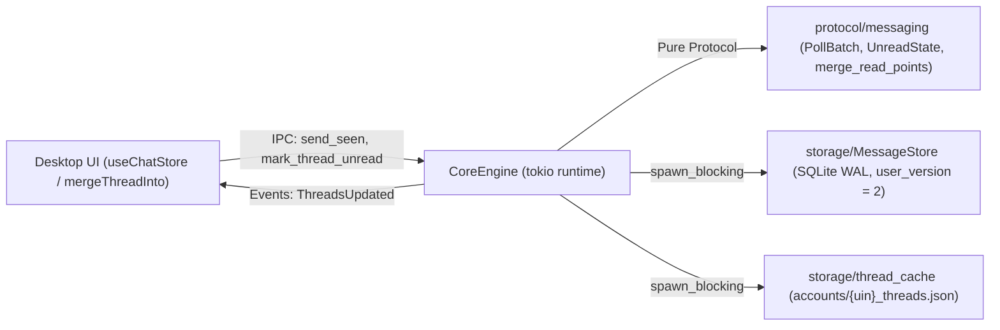
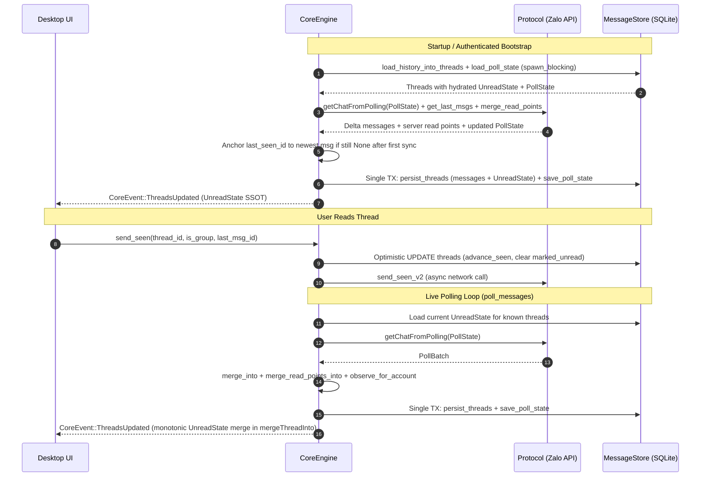

# Unread State & Poll Cursor Persistence

Formal specification for GitHub Issue [#74](https://github.com/ngxccc/alolite/issues/74): persisting read/unread state (`UnreadState`) and long-poll cursors (`PollState`) in SQLite so restarting `AloLite` preserves `unread_count = 0` and loads history from `MessageStore` instead of replaying from scratch.

## Overview & Context

### Problem Statement

After syncing and reading all messages in a session, restarting `AloLite` resets conversation badges to `Chưa đọc (99+)` (with individual threads showing `60`, `53`, `12`) and re-fetches cloud history from scratch. Root-cause analysis identified four independent defects:

1. **Frontend count fabrication**: `mergeThreadsUpdate` in `apps/desktop/src/stores/use-chat-store.ts` increments `unreadCounts[id]` using `merged.messages.length - oldLen` whenever `ThreadsUpdated` delivers more messages than `list_threads` preloaded (`MessageStore::PRELOAD_MSGS = 20`), and `threadUnreadCount` in `apps/desktop/src/features/threads/utils/threads.ts` takes `Math.max(serverCount, local)`.
2. **Ephemeral `PollState` & unconditional cloud reload**: `finish_authenticated_bootstrap` in `crates/alolite-core/src/core/engine/auth.rs` and `refresh_threads` in `crates/alolite-core/src/core/engine/threads.rs` reset `PollState::default()` (`last_action_id = "1"`), and `poll_new_messages` in `crates/alolite-core/src/protocol/messaging/polling/fetch.rs` unconditionally calls `get_cloud_messages` (`count = 50`) for every group on every startup.
3. **Missing SQLite persistence for `UnreadState`**: `MessageStore::open` in `crates/alolite-core/src/storage/mod.rs` (`threads` table) and `StoredThread` in `crates/alolite-core/src/storage/models.rs` lack columns for `UnreadState`; `hydrate_threads` in `crates/alolite-core/src/storage/threads.rs` initializes `unread: Default::default()`.
4. **Disconnected `send_seen` & live polling**: `CoreEngine::send_seen` in `crates/alolite-core/src/core/engine/messaging.rs` only sends `send_seen_v2` over HTTP without updating SQLite or account cache; `CoreEngine::poll_messages` in `crates/alolite-core/src/core/engine/threads.rs` builds `temp_threads` with `UnreadState::default()` without calling `PollBatch::merge_read_points_into` or `UnreadState::observe_for_account`, and `mergeThreadInto` in `apps/desktop/src/features/threads/utils/threads.ts` overwrites `existing.unread` with `incoming.unread`.

### Goals

- Make `UnreadState` owned by `CoreEngine` and persisted in `MessageStore` the Single Source of Truth (SSOT) for unread badges across Desktop UI, CLI, and MCP.
- Migrate `MessageStore` atomically to `PRAGMA user_version = 2` to persist per-thread `UnreadState` fields and per-account `PollState`.
- Resume `getChatFromPolling` from the persisted `PollState` on startup/refresh and eliminate unconditional 50-message `get_cloud_messages` loops for threads that already have local history.
- Optimistically persist `send_seen` and `mark_thread_unread` locally so offline/quick-exit reads survive restarts.

### Non-Goals

- Resolving group display names or `member_count` (tracked separately under `#71`).
- Changing `ParamCipher v2`, `signkey`, or wire frame IDs (`INV-1`).

## Architecture

Persistence remains strictly inside `crates/alolite-core/src/storage/` (`INV-5`), while `crates/alolite-core/src/protocol/` remains pure protocol and wire parsing. Blocking SQLite I/O runs exclusively on `tokio::task::spawn_blocking` (`INV-3`).

### Storage & Schema Design (`PRAGMA user_version = 2`)

- **Connection pragmas**: `MessageStore::open` enforces `WAL`, `synchronous = NORMAL`, `busy_timeout = 5000`, `foreign_keys = ON`, and an unsupported-version guard rejecting `user_version > 2`.
- **Extended `threads` columns**: Migration v2 expands `threads` with nullable/defaulted structured columns for `last_seen_id` (text), `unread_ids_json` (text), `marked_unread` (integer 0/1), `is_muted` (integer 0/1), and `muted_until` (nullable integer). `StoredThread` in `crates/alolite-core/src/storage/models.rs` mirrors these fields.
- **Sync cursor table (`sync_state`)**: Key-value table `(key, value)` storing serialized `PollState` under a dedicated key (`poll_state`) inside the same SQLite database.
- **Account-scoped fast-paint cache**: `load_threads_cache` and `save_threads_cache` in `crates/alolite-core/src/storage/thread_cache.rs` scope strictly to `accounts/{uin}_threads.json` when `uin` is present, preventing cross-account badge bleed.

## Operational Flow

### Key Behavioral Rules

- **Frontend SSOT**: `mergeThreadsUpdate` in `apps/desktop/src/stores/use-chat-store.ts` no longer derives `unreadCounts` from `merged.messages.length - oldLen`. `mergeThreadInto` in `apps/desktop/src/features/threads/utils/threads.ts` merges `existing.unread` and `incoming.unread` monotonically (preserving the higher numeric `last_seen_id`, unioning `unread_ids` strictly greater than `last_seen_id`, and never letting a default/non-fresh `UnreadState` erase a populated one).
- **Conditional history fetch**: `poll_new_messages` in `crates/alolite-core/src/protocol/messaging/polling/fetch.rs` drops the unconditional per-group `get_cloud_messages(..., "0", false, 50)` loop on startup/refresh. It only fetches `get_cloud_messages` for a thread if the thread has zero local messages or if `PollBatch::has_reset` is true and `get_last_msgs` reports a newer `last_message_id` than SQLite.
- **First-sync baseline anchor**: After initial bootstrap (`merge_read_points` included), if a thread has messages in SQLite but `unread.last_seen_id` is still `None`, `last_seen_id` is anchored to the thread's newest numeric `msg_id` so historical messages do not trigger `99+` while all subsequent incoming messages are counted by `observe_for_account`.

## Security & Reliability

- **Atomic commit boundary**: `PollState` (`sync_state`) is written in the **same SQLite transaction** as `persist_threads`. A crash mid-sync rolls back both `messages`/`UnreadState` and `PollState`, preventing cursor advancement without persisted messages.
- **Offline / network-failure resilience**: `CoreEngine::send_seen` and `CoreEngine::mark_thread_unread` persist `UnreadState` locally before/regardless of HTTP `send_seen_v2` / `set_unread_mark` outcome. If the server request fails, the local badge remains cleared; if a newer `read_point` later arrives from another device, `advance_seen` moves forward monotonically.
- **Long-poll `has_reset` recovery**: When the server expires old queue state (`PollBatch::has_reset == true`), `CoreEngine` logs a structured warning, runs `get_last_msgs` across known threads to patch preview gaps, and fetches `get_cloud_messages` only for threads with a newer server `last_message_id`.
- **Privacy & credential boundary**: `sync_state` stores only `PollState` (`last_action_id` and queue IDs). No `session.json` tokens, cookies, `zpw_sek`, or `zpw_enk` are ever written to SQLite (`INV-2`).

## Domain Invariant Taxonomy

### Invariants (`INV-1..6`)

| ID        | Invariant                                                                                                                       | Enforcing Symbol                                               | Verification Test (`:memory:` SQLite / Unit)                                                                              |
| :-------- | :------------------------------------------------------------------------------------------------------------------------------ | :------------------------------------------------------------- | :------------------------------------------------------------------------------------------------------------------------ |
| **INV-3** | UI thread never blocks on SQLite or disk cache I/O                                                                              | `CoreEngine::list_threads`, `CoreEngine::send_seen`            | All `MessageStore` calls execute inside `tokio::task::spawn_blocking`                                                     |
| **INV-4** | Message rows are idempotent by `msg_id`; re-delivery never duplicates history                                                   | `MessageStore::upsert_message`                                 | `test_insert_twice_returns_false` (`crates/alolite-core/src/storage/mod.rs`)                                              |
| **INV-5** | `protocol/` never imports `rusqlite` or `thread_cache`                                                                          | `crates/alolite-core/src/protocol/`                            | `cargo clippy --workspace --all-targets -- -D warnings`                                                                   |
| **INV-6** | `last_seen_id` is monotonic (never regresses); `PollState` advances atomically with ingested messages in one SQLite transaction | `UnreadState::advance_seen`, `persist_threads_with_poll_state` | `unread_cursor_and_poll_state_commit_atomically_inv6`, `unread_last_seen_id_is_monotonic_across_hydrate_and_persist_inv6` |

### Edge Cases & Adversarial Matrix

| Case ID    | Class         | Scenario                                                                               | Expected Behavior                                                                                                                                                   |
| :--------- | :------------ | :------------------------------------------------------------------------------------- | :------------------------------------------------------------------------------------------------------------------------------------------------------------------ |
| **EDGE-1** | Boundary      | Thread has `last_seen_id = None` and server omits `read_point` on first bootstrap      | Anchor `last_seen_id` to newest numeric `msg_id`; `unread_ids` stays empty (`0`), future messages > anchor count normally                                           |
| **EDGE-2** | Boundary      | Migration v1 → v2 on existing DB with thousands of threads/messages                    | Idempotent `ALTER TABLE` + `CREATE TABLE IF NOT EXISTS sync_state` bumps `user_version = 2`; existing threads default to `last_seen_id = NULL`, `marked_unread = 0` |
| **ADV-1**  | Concurrency   | `ThreadsUpdated` arrives while user has a thread open or immediately after `send_seen` | `mergeThreadInto` and `persist_threads` apply monotonic `advance_seen`; older server/poll snapshot cannot resurrect cleared `unread_ids`                            |
| **ADV-2**  | Failure       | Process crashes mid-`poll_new_messages` before transaction commit                      | SQLite rolls back both `messages`/`threads` and `sync_state.poll_state`; next restart replays safely from previous `PollState`                                      |
| **ADV-3**  | Failure       | `send_seen_v2` fails due to offline/timeout, then user restarts app                    | Local `last_seen_id` was already persisted optimistically; restart keeps `unread_count = 0`                                                                         |
| **ADV-4**  | Multi-Account | User switches account (`switch_account`)                                               | `accounts/{uin}_history.db` and `accounts/{uin}_threads.json` isolate `UnreadState` and `PollState` per `uin`                                                       |
