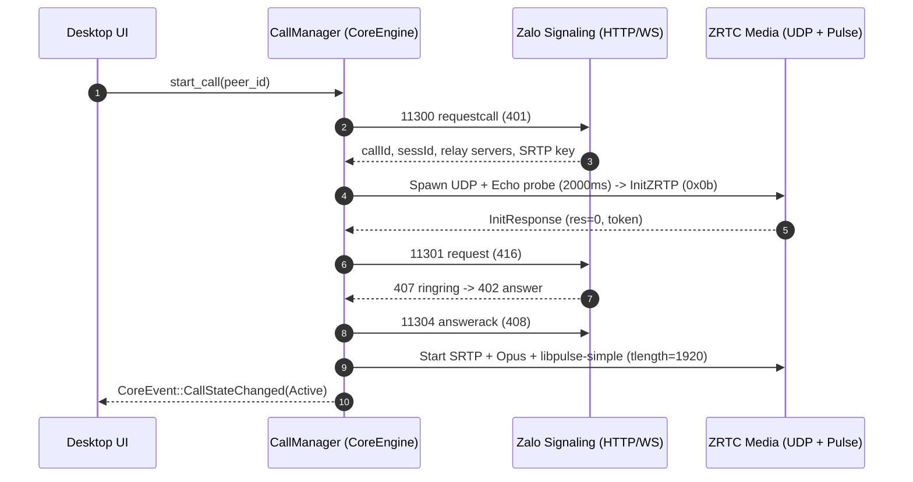
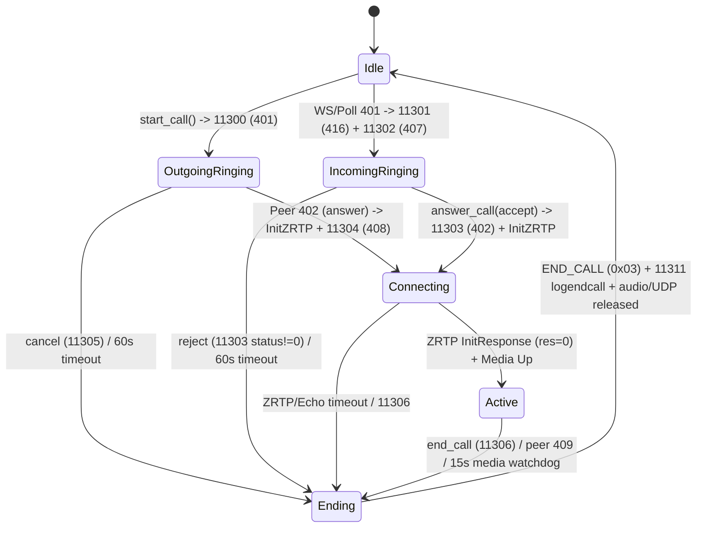

# 1-1 Audio Call Engine (ZRTC)

Formal specification for implementing **1-1 Voice Calls** in `alolite` (`alolite-core` + `apps/desktop`) over Zalo's custom **ZRTC** UDP/ZRTP/SRTP protocol, per [ADR-0008](../adr/0008-pure-rust-zrtc-audio-call-engine.md) and [GLOSSARY.md](../../GLOSSARY.md).

## Overview & Context

### Goals

- Support **1-1 Audio Calls** (outgoing and incoming) with ring, accept, reject, cancel, end, mute/unmute, hold/unhold, and mic/speaker device selection.
- Run signaling, ZRTP control, SRTP encryption, `NetEq` jitter buffering, Opus codec, and audio I/O purely in Rust inside `alolite-core` (`INV-3`, `INV-5`, `INV-9`).
- Support **Relay + Direct P2P (`0x7f`) + Network Handover** (`REQ_FORWARD subCmd=2` + `CHANGE_ADDRESS cmd=14`) so Wi-Fi/hotspot switches never leave audio permanently silent.
- Persist call log entries as `MessageKind::Call` in the existing `messages` table (`INV-4`, no SQLite v3 migration).

### Non-Goals (Deferred)

- **Video Call** (requires H.264 encoder/decoder, TWCC 8-byte RTP header extension RE, and resolving `supportHevcDecode` / packet loss issues documented in `re-notes/08-video-call.md`).
- **Group Call SFU** (`12433..12447`, `subCmd 12/13` spatial video layers).
- **Windows / macOS Audio Backends** in Phase 1 (deferred behind the `AudioBackend` trait; Linux `libpulse-simple` ships first).

---

## Architecture & Module Boundaries

```mermaid
flowchart LR
    UI["Desktop UI (CallModal / ActiveCallBar)"] -->|Tauri IPC: start_call, answer_call, end_call, set_call_media| Core["CoreEngine (CallManager)"]
    Core -->|CoreEvent::CallStateChanged| UI
    Core -->|Transient HTTP: 11300..11311, 12006| Proto["protocol/call/ (Pure Signaling, ZRTP, SRTP)"]
    Core -->|Bounded mpsc/watch| Media["services/call_media/ (UDP Socket, NetEq, Opus, AudioBackend)"]
    Media -->|libpulse-simple (tlength=1920)| HW["Linux PipeWire / PulseAudio"]
    Core -->|spawn_blocking| Store["storage/MessageStore (MessageKind::Call)"]
```

- **`crates/alolite-core/src/protocol/call/`** (`INV-5`): Pure signaling (`11300..11311`, `12006`), `extendData` builder/parser, `ZRTPPacket` (`0x01`/`0x02`/`0x7f` wire serialization), and RFC 3711 **SRTP** (`AES-128-CM + HMAC-SHA1-80` + `RocTracker`). Zero `rusqlite`, zero audio device imports.
- **`crates/alolite-core/src/services/call_media/`**:
  - Dedicated UDP socket loop (relay + P2P `0x7f` + 1 Hz local IPv4 route probe).
  - `NetEq` jitter buffer: decodes 20/40/60 ms Opus packets into a `1920`-sample scratch buffer, drains `320`-sample (20 ms) ticks via `carry_pcm` FIFO, advances `next_idx` on overflow prune, and runs in-band FEC (`decode_fec = 1`) on single-packet holes.
  - `AudioBackend` trait with Linux `libpulse-simple` implementation (`tlength = 1920` = 60 ms, `pa_simple_write` blocking on hardware clock).
  - System `libopus` linked via `pkg-config`, gated behind an optional Cargo feature (e.g., `call`) so environments without `libopus-dev`/`libpulse-dev` still pass `cargo test`.
- **`crates/alolite-core/src/core/engine/`**: `CallManager` owns the single `CallSession` outside `CoreEngine::session` mutex (`INV-9`), borrowing `Session` only for transient HTTP calls.

---

## Operational Flow

### `CallSession` State Machine (`INV-7`)





### Network Handover Flow (`Network Handover`)

1. 1 Hz route probe (`connect("8.8.8.8:53")` + `getsockname()`) detects local IPv4 change while `p2pState == Active`.
2. Send 3 redundant pairs (`seq = 0..2`) of `P2P.SIGNAL` (`0x7f`, `kind = 5`, `subCmd = 2`) to old peer P2P address and `REQ_FORWARD` (`cmd = 32`, `subCmd = 2`) to Relay Server, clearing the P2P target.
3. Send `CHANGE_ADDRESS` (`cmd = 14`, `subCmd = 1`, `magic = 1`, `sessId`) to Relay Server and arm the `3000 ms` retry timer until `SERVER_REPLY` (`msgType = 2`, `cmd = 14`).
4. Fallback detector: 25 consecutive relay audio packets (`500 ms`) while `p2pState == Active` (after `>= 5000 ms` elapsed) automatically invokes local P2P teardown to match a peer that already fell back to relay.

---

## Security & Reliability

### Invariants (`INV-7..INV-9`)

| ID        | Rule                                                                                                                                                                                                             | Verification Target                                                |
| :-------- | :--------------------------------------------------------------------------------------------------------------------------------------------------------------------------------------------------------------- | :----------------------------------------------------------------- |
| **INV-7** | **Single-Call Invariant**: At most one `CallSession` is non-`Idle`. Concurrent incoming `401` invites while non-`Idle` are auto-rejected; duplicate `callId` invites are deduplicated.                           | Unit test on `CallManager` state transitions                       |
| **INV-8** | **SRTP & Privacy Guard**: `extendData` negotiates `srtpMode: 1` (`AES-128-CM + HMAC-SHA1-80`) by default. Raw SRTP master keys, unredacted peer IPs, and PCM audio are never written to `crate::logger` or disk. | Unit test on `extendData` + Privacy Guard scan test                |
| **INV-9** | **Lock & UI Isolation**: UDP sockets, Opus encode/decode, and `AudioBackend` I/O never hold `CoreEngine::session` mutex and never run on the UI thread (`INV-3`).                                                | Code audit + headless/concurrent messaging test during active call |

---

### Edge Cases & Adversarial Matrix

### Boundary & Input (`EDGE-1..EDGE-5`)

| ID         | Scenario                                                               | Expected Behavior                                                                                                                  |
| :--------- | :--------------------------------------------------------------------- | :--------------------------------------------------------------------------------------------------------------------------------- |
| **EDGE-1** | Peer sends 40 ms or 60 ms Opus packet (`maxFT: 60`)                    | Decode into `1920`-sample scratch buffer; emit `320` samples (20 ms) and push remainder to `carry_pcm` FIFO.                       |
| **EDGE-2** | Jitter buffer overflows `max_depth`                                    | Prune `oldest_key` and advance `next_idx` to the new oldest key if `next_idx <= oldest_key` (prevents PLC starvation loop).        |
| **EDGE-3** | Single-packet hole (`cur_idx` missing, `cur_idx + 1` present)          | Call `opus_decode` on `cur_idx + 1` with `decode_fec = 1` and `frame_size = 320` before normal decode on the next tick.            |
| **EDGE-4** | Backward RTP `seq` reset across handover (e.g. `50000 -> 1000`)        | `RocTracker` tests `[0, roc + 1, roc - 1]` against the 80-bit HMAC-SHA1 tag; accepts authenticated backward reset `> 100` packets. |
| **EDGE-5** | Headless mode (`--mcp` / `--api-only`, `NoopEventSink`) receives `401` | Ignore/do not auto-answer, never open microphone or audio device; log redacted event only.                                         |

### Concurrency & Adversarial (`ADV-1..ADV-4`)

| ID        | Scenario                                                                                                    | Expected Behavior                                                                                                  |
| :-------- | :---------------------------------------------------------------------------------------------------------- | :----------------------------------------------------------------------------------------------------------------- |
| **ADV-1** | Duplicate `401` WS/poll delivery for same `callId`                                                          | Deduplicate by `callId`; never spawn a second UDP socket or audio handle.                                          |
| **ADV-2** | Second `401` from a different `callId` while `Active`/`Ringing`                                             | Reject 2nd call (`busy`), keep active `CallSession` undisturbed (`INV-7`).                                         |
| **ADV-3** | Unauthenticated / malformed UDP packet (`0x7f` wrong `callId` or `senderRole == ownRole`, or bad SRTP HMAC) | Drop immediately before jitter buffer or state mutation; increment redacted drop counter.                          |
| **ADV-4** | User clicks "End Call" twice or peer `409` arrives simultaneously with local `end_call`                     | Transition `Active -> Ending -> Idle` idempotently; `END_CALL (0x03)` and audio/UDP teardown execute at most once. |

---

### Fail-Safe Boundaries & Timeouts

| Boundary                               | Timeout   | Action on Expiry                                                                                                                                               |
| :------------------------------------- | :-------- | :------------------------------------------------------------------------------------------------------------------------------------------------------------- |
| **Ring Timeout** (Outgoing / Incoming) | `60 s`    | Send `cancel` (`11305`) or mark missed, persist `MessageKind::Call`, transition to `Idle`.                                                                     |
| **ZRTP Echo Probe**                    | `2000 ms` | Select best responsive relay from `401` server list and proceed to `InitZRTP`.                                                                                 |
| **`CHANGE_ADDRESS` (`cmd=14`) Retry**  | `3000 ms` | Retry `CHANGE_ADDRESS` up to bounded attempts; if relay remains unreachable, rely on `15 s` watchdog.                                                          |
| **Active Media Watchdog**              | `15 s`    | If zero UDP packets (RTP/RTCP/PING) arrive for `15 s`, send `END_CALL (0x03)` + `11306 endcall`, stop audio thread, release mic/speaker, transition to `Idle`. |

---

## Persistence & UI Surface

- **SQLite (`MessageKind::Call`)**: Reuse `messages` table (`PRAGMA user_version = 2`); store call outcome (completed + duration, missed, rejected, cancelled) as `MessageKind::Call` deduplicated by `msg_id` (`INV-4`).
- **Desktop UI (`apps/desktop`)**:
  - `IncomingCallModal`: caller avatar/name, Accept / Reject buttons, ringtone feedback.
  - `ActiveCallBar`: live duration timer, Mute/Unmute (`12006 conf`), Hold/Unhold (`11307`/`11309`), Mic/Speaker device selector, End Call (`11306`).
  - `MessageBubble`: render `MessageKind::Call` card in `ChatArea`.

---

## Verification Plan

1. **Unit & Protocol Tests (`cargo test --locked`)**:
   - `ZRTPPacket` (`0x01`, `0x02`, `0x7f` `kind 1..9`) round-trip serialization/deserialization.
   - SRTP `AES-128-CM + HMAC-SHA1-80` encrypt/decrypt + `RocTracker` backward-reset fallback (`EDGE-4`).
   - `NetEq` `carry_pcm` multi-frame drain (`EDGE-1`), overflow `next_idx` advance (`EDGE-2`), and FEC hole recovery (`EDGE-3`).
   - `CallManager` state machine (`INV-7`, `ADV-1..ADV-4`, `EDGE-5` headless guard).
2. **Feature-Gated Build Check**: Verify both `cargo check --workspace` (default, no `libopus-dev` required) and `cargo check --workspace --features call` (with system `libopus` + `libpulse-simple`).
3. **Live Verification**: 1-1 outgoing & incoming audio call against official Zalo mobile/desktop client, including Wi-Fi/hotspot handover test (`cmd=14` + `REQ_FORWARD subCmd=2`).

---

## Audio Diagnostics & Debugging

- **Persistent Call Telemetry (`ALOLITE_CALL_DEBUG`)**: Disabled by default. Enable with `ALOLITE_CALL_DEBUG=1` (also auto-enabled when `ALOLITE_CALL_DUMP_WAV` is set) to stream redacted `[DEBUG-call]` diagnostics to stderr and `<data_dir>/call-debug.log` via `logger::enable_call_log_from_env` (`media_stats`, `capture_stats`, `playout_stats`, `first_tx_rtp`, `capture_open`/`playback_open`, `apm_delay_ms`), with zero secrets or credentials (`INV-8`).
- **3-Channel WAV Dump (`ALOLITE_CALL_DUMP_WAV`)**: Disabled by default (`crates/alolite-core/src/services/call_media/wav_dump.rs`). Enable only for local AEC/NS/AGC DSP inspection:
  - Set `ALOLITE_CALL_DUMP_WAV=1` (writes `<data_dir>/call-dump-<call_id>.wav`, e.g. `~/.local/share/alolite/call-dump-<call_id>.wav`) or `ALOLITE_CALL_DUMP_WAV=/custom/dir`.
  - Format: `16000 Hz`, `16-bit` signed PCM, `3` interleaved channels (`ch0 = mic_raw` pre-APM, `ch1 = mic_proc` post-APM/AGC, `ch2 = speaker_render` playout & AEC reference).
  - Non-blocking: capture and playout threads push frames via bounded `SyncSender::try_send` (`256` frames) to the dedicated `alolite-wav-dump` writer thread so the 20 ms PulseAudio clock never stalls on disk I/O (`INV-9`).
  - **Privacy**: Delete `call-dump-*.wav` immediately after analysis; never commit `.wav` dumps.
